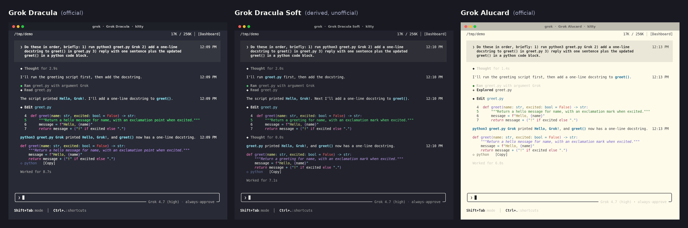
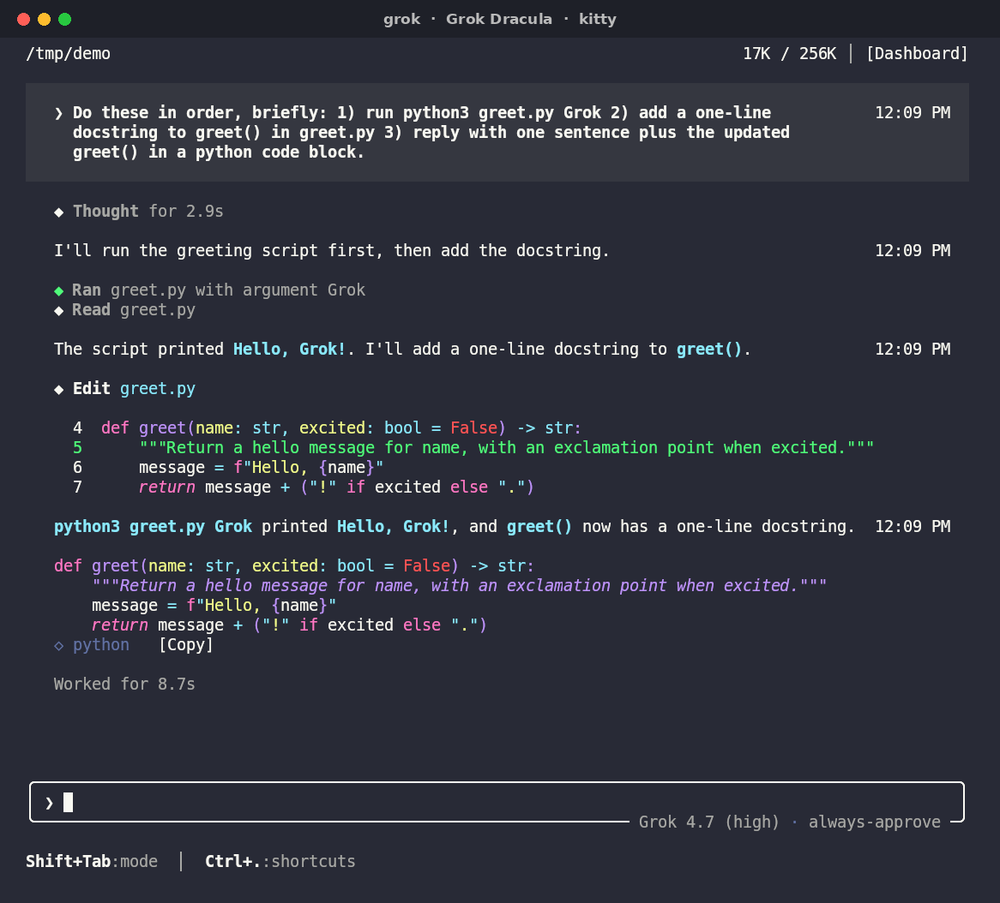
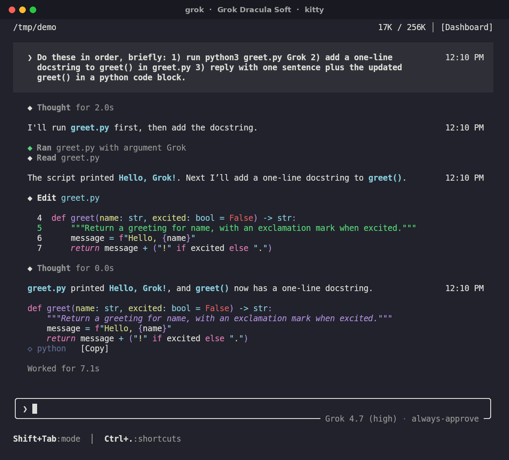
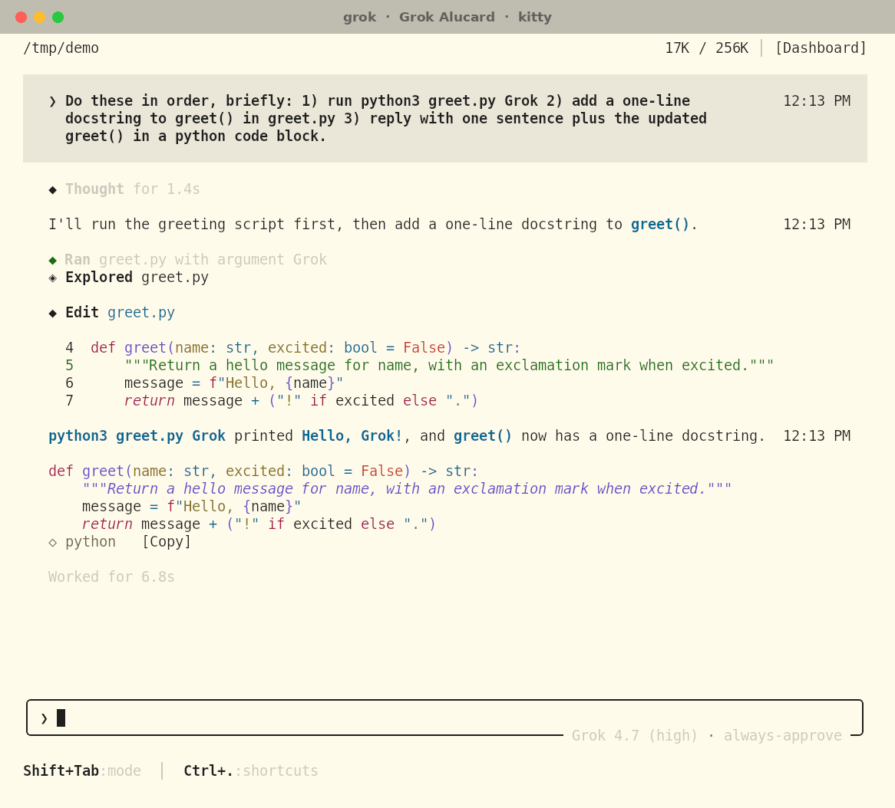

# Grok Build Dracula

Dracula, Dracula Soft and Alucard colors for the [Grok Build](https://x.ai) CLI (`grok`).


*This animation is a re-rendered illustration, not a screen recording; the screenshots under [Previews](#previews) are real captures. There's also a [1080p MP4](previews/animated.mp4).*



## How this works

**Grok Build doesn't load custom theme files.** Its color themes (`groknight`, `tokyonight` and the rest) are compiled into the binary, and `config.toml` can only pick one by name.

This pack uses Grok's built-in **`terminal`** theme instead. That theme paints no backgrounds and takes every color from your terminal's 16-color ANSI palette, so loading a Dracula scheme in your terminal makes Grok render in Dracula. That's what's in here:

- color schemes for iTerm2, Ghostty, WezTerm, kitty, Alacritty and Windows Terminal, in three variants. They're all generated from one palette file per variant.
- `install.sh`, which switches Grok to the `terminal` theme and installs the scheme for your terminal.

The `terminal` theme is still rolling out. Until it reaches your account, Grok needs `[features] terminal_theme = true` in `config.toml` (the installer sets it) or `GROK_TERMINAL_THEME=1` in the environment. Without one of these, Grok quietly falls back to its default theme.

| Variant | Status | Background | Notes |
|---|---|---|---|
| `dracula` | official | `#282A36` | Values from the [Dracula spec](https://draculatheme.com/spec) |
| `dracula-soft` | **derived, unofficial** | `#21222C` | Darker official background. Accents have HSL saturation ×0.8, then a 12% mix toward the background. See `palettes/dracula-soft.toml` |
| `alucard` | official (light) | `#FFFBEB` | Dracula's official light variant |

## Previews

These are real screenshots: Grok Build 1.0 in its `terminal` theme, running in kitty 0.49 with this repo's generated kitty schemes (default kitty settings, DejaVu Sans Mono).

| Dracula | Dracula Soft | Alucard |
|---|---|---|
|  |  |  |

**Tested** in real terminals on Linux: kitty 0.49.2, WezTerm 20240203 and Ghostty 1.3.1, all installed with `install.sh`. The iTerm2, Alacritty and Windows Terminal files are generated from the same palettes and checked to parse (plist, TOML, JSON), but haven't been opened in those apps yet.

The same schemes in other terminals: [WezTerm + Dracula](previews/wezterm-dracula.png), [Ghostty + Alucard](previews/ghostty-alucard.png).

## Install

### Quick install

> The repo is **private** for now, so plain `curl` gets a 404. Use the GitHub CLI (`gh auth login` first):

```sh
gh api -H "Accept: application/vnd.github.raw" \
  "repos/rystedtcreative/grok-build-dracula/contents/install.sh?ref=main" | sh -s -- --variant dracula
```

Once the repo is public:

```sh
curl -fsSL https://raw.githubusercontent.com/rystedtcreative/grok-build-dracula/main/install.sh | sh -s -- --variant dracula
```

When it runs from a pipe, the installer clones the repo into `~/.local/share/grok-build-dracula/src`, using `git` or `gh`.

### From a clone

```sh
git clone https://github.com/rystedtcreative/grok-build-dracula.git   # or: gh repo clone rystedtcreative/grok-build-dracula
cd grok-build-dracula
./install.sh --dry-run                    # see what it would do
./install.sh --variant dracula            # or dracula-soft, alucard
```

### What the installer does

- It backs up `~/.grok/config.toml` to `config.toml.bak-grok-dracula-<timestamp>`, then sets `[ui] theme = "terminal"` and `[features] terminal_theme = true`. It changes only those two keys. Comments, key order and every other table stay as they were. It never adds a duplicate `[ui]` or `[features]` table, and it re-parses the result and refuses to write if anything else would change. This edit needs `python3` 3.11+ (or `tomli`). Without it, the installer prints the lines for you to add by hand.
- It detects your terminal (or takes `--terminal`), installs the matching scheme file and prints the step that turns it on. It never silently overwrites: if a file with the same name exists and this installer didn't write it, the file is left alone and you're told. `--force` replaces it and keeps a backup.
- It's idempotent. Running it again changes nothing. Running it with another `--variant` just adds that scheme.
- `--with-pager` installs `extras/pager.toml` (optional layout tweaks) as `~/.grok/pager.toml`, but only if you don't have one. Otherwise the snippet is printed for you to merge by hand.

```
--variant dracula|dracula-soft|alucard   (default dracula)
--terminal auto|iterm2|ghostty|wezterm|kitty|alacritty|windows-terminal|all|none
--with-pager   --dry-run   --force   --uninstall   --restore-backup   --help
```

### Try it without touching your config

```sh
GROK_THEME=terminal GROK_TERMINAL_THEME=1 grok
```

Run that in a terminal that already uses one of the schemes below.

## Manual setup, per terminal

First tell Grok to use the terminal theme. Add this to `~/.grok/config.toml`, merging it into any existing `[ui]` and `[features]` tables:

```toml
[ui]
theme = "terminal"

[features]
terminal_theme = true
```

Once the feature is on, you can also pick **Terminal** from `/theme` inside Grok. Then load a scheme in your terminal:

| Terminal | File | Activate |
|---|---|---|
| **Ghostty** | `themes/ghostty/grok-dracula` → `~/.config/ghostty/themes/` | `theme = grok-dracula` in the Ghostty config. For a light/dark pair: `theme = light:grok-alucard,dark:grok-dracula` |
| **kitty** | `themes/kitty/grok-dracula.conf` → `~/.config/kitty/themes/` | `kitten themes --reload-in=all "Grok Dracula"`, or `include themes/grok-dracula.conf` in `kitty.conf`, then reload with Ctrl+Shift+F5 |
| **WezTerm** | `themes/wezterm/grok-dracula.toml` → `~/.config/wezterm/colors/` | `config.color_scheme = "Grok Dracula"` |
| **Alacritty** | `themes/alacritty/grok-dracula.toml` → `~/.config/alacritty/themes/` | `[general]` `import = ["~/.config/alacritty/themes/grok-dracula.toml"]`. In 0.13 and older, put `import` at the top level |
| **iTerm2** | `themes/iterm2/grok-dracula.itermcolors` | Settings → Profiles → Colors → Color Presets… → Import…, then pick **grok-dracula** (or just `open` the file) |
| **Windows Terminal** | `themes/windows-terminal/grok-dracula.json` | Settings → Open JSON file. Add the object to `"schemes"`, then set `"colorScheme": "Grok Dracula"` on your profile |

Substitute `dracula-soft` / `Grok Dracula Soft` or `alucard` / `Grok Alucard` for the other variants. These are ordinary terminal schemes, so your shell, `git` and `ls` pick up Dracula too.

## Uninstall

```sh
./install.sh --uninstall                   # or pipe it as above with: sh -s -- --uninstall
./install.sh --uninstall --restore-backup  # put back the exact pre-install config.toml
```

`--uninstall` sets `[ui] theme` back to what it was before installing. If it wasn't set, the key is removed, which means Grok's default `groknight`. It also undoes `terminal_theme` and deletes the scheme and pager files the installer added, as long as you haven't edited them. Config backups are kept. Switch your terminal back to its old color scheme in its own settings.

## Caveats

- **Syntax highlighting follows the palette, but with Grok's role mapping, not Dracula's.** Grok picks which ANSI slot each token uses. Keywords come out pink, strings yellow, types and builtins cyan, and docstrings italic purple, all of which match Dracula. Function names come out purple (Dracula specifies green), and `False`/`True` come out red (Dracula specifies purple). Inserted diff lines are green.
- **256/16-color terminals.** Nearly everything Grok draws in this theme is an ANSI palette index (`38;5;0-15`), so it looks the same with `TERM=xterm-256color` or plain `xterm` and needs no 256-color approximation. There's one exception. Grok asks the terminal for its background and foreground colors (OSC 10/11) and draws the prompt block with a 24-bit tint of that background, and it sends this tint even when `COLORTERM`/`TERM` don't advertise truecolor. A terminal without truecolor approximates or drops that one tint. A terminal that doesn't answer the query (tmux without passthrough, for example) shows no tint. Everything else is unaffected.
- **Faint text on Alucard.** Grok draws secondary text (tool names, "Worked for", hints) as *dim* bright-black. Terminals render dim at reduced opacity, which is subtle on dark backgrounds but quite faint on Alucard's cream. To make it more legible, raise the dim opacity: Ghostty `faint-opacity = 0.8` (tested) or kitty `dim_opacity 0.75`.
- **`--minimal` mode** always uses the terminal palette and ignores `theme`, so these schemes apply there too.
- Nothing here patches or replaces the `grok` binary. Switching back to any built-in theme is just `/theme`.

## Repository layout

```
palettes/*.toml          single source of truth (one file per variant)
scripts/generate.py      palettes → themes/ (python3 scripts/generate.py [--check])
scripts/grok_config.py   the careful config.toml editor used by install.sh
themes/<terminal>/       generated schemes, don't edit by hand
install.sh               installer (POSIX sh)
extras/pager.toml        optional Grok layout tweaks
tests/test_install.sh    installer tests against throwaway HOMEs (sh tests/test_install.sh dash)
scripts/capture_previews.sh, scripts/frame_previews.py   how previews/ was made
```

To change a color, edit `palettes/<variant>.toml`, then run `python3 scripts/generate.py`.

## Credits and license

The Dracula and Alucard palettes are from the [Dracula Theme](https://draculatheme.com) project by Zeno Rocha and contributors, used under the MIT License. Dracula Soft is this project's derivation and is not an official Dracula variant. Grok Build is a product of xAI, and this project isn't affiliated with xAI or Dracula Theme.

MIT © 2026 R Creative / Joshua Rystedt. See [LICENSE](LICENSE).
